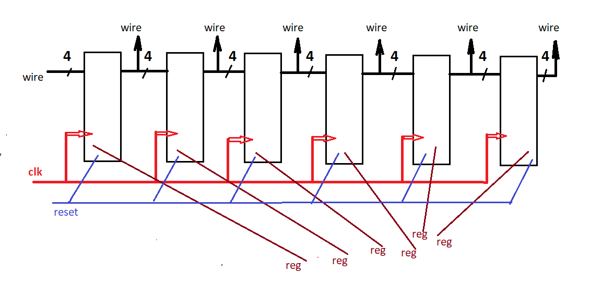
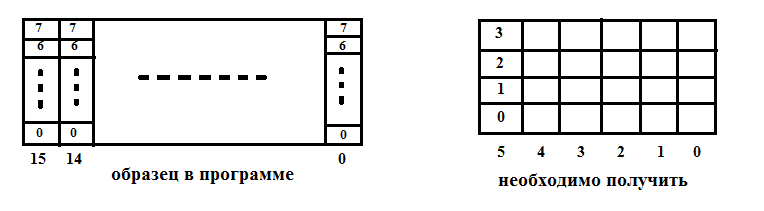

 - Рис. 4.1. Блок-схема реализуемого устройства
 - Рис. 4.3. Графическое соответствие образца и задания
<!-- Сюда вставляются скриншоты диаграмм из ModelSim после моделирования: -->
<!--  - shift_reg_tb -->
<!--  - count_div_tb -->
<!--  - coder_tb -->
<!--  - main_tb -->
<!--  - main_hello_tb -->
